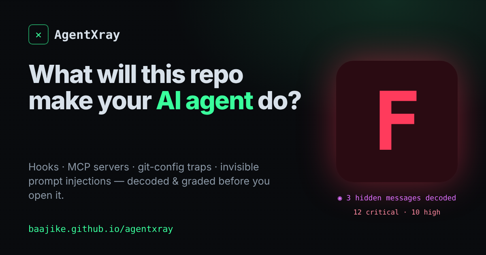

<div align="center">

# AgentXray

### See what a repo will make your AI agent do, before you open it.

**[Try it in your browser](https://baajike.github.io/agentxray/)** · [Run the attack demo](https://baajike.github.io/agentxray/#demo) · [Browser extension](#browser-extension) · [CLI](#cli) · [GitHub Action](#github-action)

Hooks, MCP servers, auto-run tasks, git-config traps and **invisible** prompt injections.
Decoded, graded A to F, and placed on the exact moment they fire.

For **Claude Code · Cursor · Copilot · Codex · Gemini CLI · Windsurf · Cline · Kiro**

  



</div>

---

## Why this exists

In 2026, opening a repo stopped being safe.

- **GitSpawn.** A repo's own `.git/config` can set `core.fsmonitor` to a command. Coding agents run `git status` in the background on startup, so the command runs. In some agents it fires before the workspace-trust prompt.
- **Mini Shai-Hulud** hit 170+ npm and PyPI packages and persisted through Claude Code hooks and VS Code auto-run tasks.
- Vendors describe repo-shipped hooks as working "by design". The repo author decides what runs on your machine.
- Text hidden with Unicode tags or variation selectors is invisible on GitHub and in your editor, and read perfectly by the model.

Existing tools either scan your own MCP servers, or ask you to install a CLI to inspect code you don't trust yet. AgentXray works in the browser, without cloning, and tells you not just what is dangerous but when it fires.

## What makes it different

| | |
|---|---|
| **Attack timeline** | Every finding is placed on the moment it fires: folder open, agent session, git, agent reads, install, run. You see at a glance what happens before you or the agent decide anything. |
| **Decodes hidden messages** | It doesn't just report "suspicious Unicode". It decodes and shows the smuggled instruction: Unicode tags, variation-selector smuggling, zero-width binary, hidden HTML comments. |
| **No install, no clone** | Paste a GitHub URL and files are read over HTTPS (clones can fire hooks). Or drop a folder or zip. Nothing leaves your browser. |
| **A grade on every GitHub page** | The browser extension adds an A to F badge next to the repo name, so you see the risk before you click Clone. |
| **Honest grades** | Precision first. Anthropic's `claude-code` repo and Vercel's `ai` repo score B with accurate notes, Express scores A, the trap repo scores F. No "everything is critical" noise. |
| **Repos can't silence themselves** | A scanned repo's own ignore file is never trusted. Only your `--ignore-file` counts. |
| **One engine everywhere** | Website, extension, zero-dependency CLI, GitHub Action with SARIF, README badge. |

## What it checks (45+)

| Fires on | Checks |
|---|---|
| **1. Folder opened** | VS Code and Cursor tasks with `runOn: folderOpen` · devcontainer `initializeCommand` (runs on your host) · docker-socket and home-dir mounts · workspace settings pointing at binaries · terminal env overrides · `.envrc` |
| **2. Agent session** | Claude Code, Gemini, Cursor, Codex and Copilot hooks (SessionStart, PreToolUse and others) · `ANTHROPIC_BASE_URL` and proxy redirection · `apiKeyHelper` · `bypassPermissions` · pre-approved `Bash` and `WebFetch` · `enableAllProjectMcpServers` · MCP servers (unpinned `npx -y`, plain-HTTP remotes, hardcoded keys) · auto-approve settings · skills with unrestricted Bash |
| **3. Agent runs git** | `.git/config`: `core.fsmonitor`, `hooksPath`, `sshCommand`, `pager`, `askPass`, `filter.*`, `textconv`, shell credential helpers and aliases · active `.git/hooks` · `.gitattributes` filters |
| **4. Agent reads files** | Hidden Unicode (decoded) · hidden HTML comments addressed to the AI · instruction-override, conceal-from-user and exfiltration language in `CLAUDE.md`, `AGENTS.md`, `GEMINI.md`, `.cursor/rules`, `copilot-instructions.md`, `SKILL.md` and more · bidi "Trojan Source" · symlinks escaping the repo |
| **5. Install** | npm `preinstall`, `postinstall` and `prepare` · URL and git dependencies · `yarnPath` · `.npmrc` `script-shell`, `node-options` and registry swaps · `setup.py` |
| **6. Tests and build** | `conftest.py` payloads (pytest), `.pth` files, risky npm scripts, download-and-execute in scripts and Dockerfiles, Gradle wrapper URLs |
| **7. Exposed** | Committed API keys (Anthropic, OpenAI, GitHub, AWS and others), `settings.local.json`, `pull_request_target` pwn-requests, AI agents in CI triggered by public comments |

Every command found is analysed for download-and-execute, reverse shells, encoded payloads, credential access, persistence and exfiltration, and its severity rises accordingly.

## Browser extension

Adds an AgentXray grade next to the repo name on every GitHub repository page. Results are cached per commit, so revisiting a repo is instant. Click the badge for the full report.

Install (Chrome, Edge, Brave, Arc):

1. Download [agentxray-extension.zip](https://baajike.github.io/agentxray/agentxray-extension.zip) and unzip it.
2. Open `chrome://extensions` and turn on **Developer mode**.
3. Click **Load unpacked** and choose the unzipped folder.

Open any repo on GitHub and the badge appears beside its name. An optional GitHub token in the extension's options raises the limit from about 30 to about 2,500 repo scans per hour. It is stored only in your browser.

## CLI

Zero dependencies, Node 18+.

```bash
npx github:Baajike/agentxray .                 # scan the current folder (includes .git/config and hooks)
npx github:Baajike/agentxray owner/repo        # scan a GitHub repo without cloning it
npx github:Baajike/agentxray --demo            # see a full attack, defanged
```

```
  ▌▌ AgentXray  v0.2.0  ·  what can this repo make your AI agent do?
  totally-legit/react-starter (built-in demo)  ·  14 files read in 20ms  ·  nothing was executed
  ──────────────────────────────────────────────────────────────────────
    F    0/100   Do not open this with an AI agent.
         12 critical  ·  10 high  ·  1 medium  ·  1 low   ·  3 hidden messages decoded
  ──────────────────────────────────────────────────────────────────────
  WHEN IT FIRES
  ● OPEN 5 ─ ● SESSION 9 ─ ● GIT 1 ─ ● READ 5 ─ ● INSTALL 3 ─ ● RUN 1 ─ ○ EXPOSED
```

| Flag | |
|---|---|
| `--json` / `--sarif` | machine output (SARIF 2.1.0) |
| `--out <file>` | write to file |
| `--fail-on <sev>` | exit 1 at or above `critical`, `high`, `medium` or `low` |
| `--ignore-file <path>` | your own ignore list (rule ids or globs) |
| `--badge` | README badge markdown |
| `--verbose` | why and fix for every finding |
| `GITHUB_TOKEN` | higher API limit for remote scans |

## GitHub Action

```yaml
name: AgentXray
on: [pull_request, push]
permissions: { contents: read, security-events: write }
jobs:
  xray:
    runs-on: ubuntu-latest
    steps:
      - uses: actions/checkout@v4
      - uses: Baajike/agentxray@main
        with:
          fail-on: high
```

Findings appear in **Security, Code scanning** and in the job summary. It catches PRs that sneak in a hook, an MCP server or invisible text.

## README badge

```bash
npx github:Baajike/agentxray . --badge
```
[](https://baajike.github.io/agentxray/)

## Grades

| | |
|---|---|
| **A** | Clean. Nothing runs code or steers your agent without you noticing. |
| **B** | Mostly safe. A few things run automatically, so glance at them. |
| **C** | Review first. Several ways to run code or influence your agent. |
| **D** | Risky. Open only in a disposable container until reviewed. |
| **F** | At least one critical. Something executes or hijacks the agent on its own. |

## How it works

- `src/engine.js` is one pure ES module with zero dependencies, shared by the site, extension, CLI and Action. It never executes anything it reads.
- Remote scans use the GitHub tree API plus raw files, and only fetch files that can run code or reach an agent (usually a few dozen requests).
- Local scans read `.git/config` and `.git/hooks`, the attack surface GitHub never shows you.

## Limits

AgentXray is triage, not a guarantee. It reads configs and text; it doesn't run or sandbox code, and a determined attacker can hide logic inside ordinary source files. When in doubt, open untrusted code in a throwaway container with no secrets mounted.

## Contributing

Found a new attack technique? Open an issue with a defanged sample (use `example.invalid` URLs). Rules live in `src/engine.js`, tests in `test/`.

```bash
npm test
```

---

<div align="center">

Built by **[Immanuella Baajike](https://github.com/Baajike)** · MIT licensed · Star it if it saved you from a bad repo

</div>
